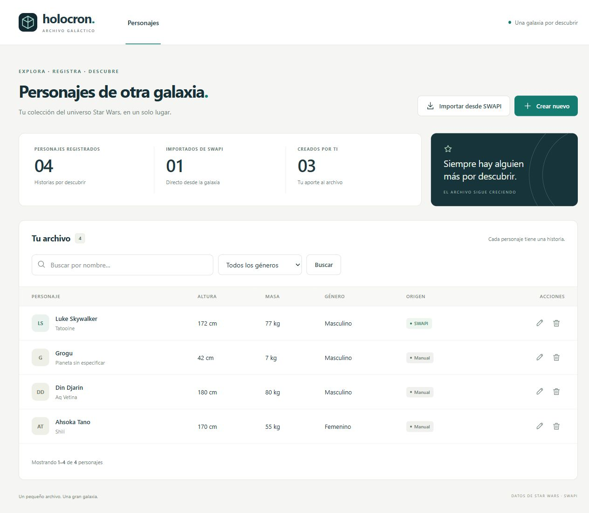

# Sistema de Gestión de Personajes Star Wars

**Holocron** es una aplicación para registrar personajes, editar sus características e importar datos desde SWAPI. Implementa Laravel, Vue 3 e Inertia sin un starter kit de autenticación.



## Información del candidato

- Nombre: Daniel Ureta Espinal
- Email: duretae@gmail.com
- Teléfono: +51 991 923 046
- GitHub: [Daniel349167](https://github.com/Daniel349167)
- Portafolio: [daniel349167.github.io](https://daniel349167.github.io/)

## Requisitos del sistema

- PHP **8.2 o superior** y extensiones habituales de Laravel, incluyendo `pdo_mysql`, `mbstring`, `curl` y `openssl`.
- Composer 2.
- Node.js **22.12 o superior** y npm. También es compatible Node 20.19+.
- MySQL 8+. La aplicación también se verificó con MariaDB 10.4.
- Para ejecutar las pruebas por defecto: `pdo_sqlite`.

Se eligió Laravel 12 porque la prueba admite Laravel 10+ y el entorno disponible utiliza PHP 8.2. Vue e Inertia se instalaron manualmente sobre una aplicación creada con `laravel new`, sin Breeze ni Jetstream. Las versiones exactas están fijadas en los archivos lock.

## Instalación

### 1. Clonar e instalar dependencias

```bash
git clone https://github.com/Daniel349167/mau-starwars.git
cd mau-starwars
composer install
npm ci
```

### 2. Crear la base de datos

Ejecutar en MySQL:

```sql
CREATE DATABASE mau_starwars
    CHARACTER SET utf8mb4
    COLLATE utf8mb4_unicode_ci;
```

### 3. Configurar el entorno

En macOS/Linux:

```bash
cp .env.example .env
```

En PowerShell:

```powershell
Copy-Item .env.example .env
```

Editar `.env` con las credenciales locales:

```dotenv
APP_URL=http://localhost:8000
DB_CONNECTION=mysql
DB_HOST=127.0.0.1
DB_PORT=3306
DB_DATABASE=mau_starwars
DB_USERNAME=root
DB_PASSWORD=
```

El archivo `.env` nunca debe publicarse. No es necesario configurar correo, Redis ni workers de colas.

### 4. Preparar y ejecutar

```bash
php artisan key:generate
php artisan migrate
npm run build
php artisan serve
```

Abrir [http://localhost:8000/personajes](http://localhost:8000/personajes).

Opcionalmente, cargar tres registros manuales ilustrativos para la demostración:

```bash
php artisan db:seed
```

El seeder no consulta Internet ni crea registros con origen SWAPI. Se puede ejecutar más de una vez sin duplicar sus registros originales.

Para trabajar con recarga automática, mantener `php artisan serve` en una terminal y ejecutar `npm run dev` en otra. Para una demostración sencilla basta con el build.

## Funcionalidades implementadas

- CRUD completo y paginación de 10 registros por página.
- Nombre obligatorio, de 3 a 100 caracteres.
- Altura y masa opcionales, enteros positivos con máximos de 300 cm y 500 kg.
- Género restringido a `masculino`, `femenino` y `n/a`.
- Textos opcionales limitados a 100 caracteres.
- Importación de IDs del 1 al 83 desde `https://swapi.py4e.com/api/people/{id}/`.
- Traducción de nombres de campos y valores de género al modelo local.
- Consulta del nombre del planeta de origen cuando está disponible.
- Prevención de duplicados por validación y restricción única en la base de datos.
- Manejo de timeout, errores de conexión, 404, 429, 5xx y respuestas inválidas.
- Formularios con `useForm`, errores del backend y estados de carga.
- Confirmación antes de eliminar.
- Mensajes de éxito y avisos visibles.
- Interfaz adaptable a móviles, navegación con teclado y modales nativos con foco confinado.

Extras incluidos: servicio para SWAPI, pruebas de integración, seeder, búsqueda por nombre y filtro por género. La búsqueda se aplica al pulsar **Buscar** o Enter.

## Tecnologías

| Capa | Tecnología |
| --- | --- |
| Backend | Laravel 12, PHP 8.2+ |
| Frontend | Vue 3, Composition API, `<script setup>` |
| Navegación y formularios | Inertia.js 2 |
| Base de datos | MySQL / MariaDB |
| Estilos | Tailwind CSS 4 y CSS propio |
| Compilación | Vite 7 |
| Pruebas | PHPUnit 11 y HTTP fakes de Laravel |

## Rutas

| Método | URL | Función |
| --- | --- | --- |
| GET | `/personajes` | Listado paginado |
| GET | `/personajes/crear` | Formulario de creación |
| POST | `/personajes` | Guardar |
| GET | `/personajes/{id}/editar` | Formulario de edición |
| PUT | `/personajes/{id}` | Actualizar |
| DELETE | `/personajes/{id}` | Eliminar |
| POST | `/personajes/importar` | Importar por `swapi_id` |

## Pruebas y verificación

```bash
php artisan test
php vendor/bin/pint --test
npm run build
```

Las pruebas usan SQLite en memoria para ser reproducibles sin una base de datos externa. Las llamadas a SWAPI se simulan y se impiden solicitudes inesperadas, por lo que la suite funciona sin Internet. Se verificó también la suite sobre una base independiente de MariaDB, usando el driver `mysql`.

Los **48 casos, con 197 aserciones**, cubren CRUD, paginación, filtros, validaciones, metadatos de origen, importación, errores HTTP, fallo de conexión, datos inválidos, normalización, planeta no disponible y duplicados incluso cuando otro registro se inserta durante la consulta externa.

Para probar sobre MySQL/MariaDB, crear **una base exclusiva para pruebas**, por ejemplo `mau_starwars_testing`, y configurar las variables `DB_CONNECTION`, `DB_HOST`, `DB_PORT`, `DB_DATABASE`, `DB_USERNAME` y `DB_PASSWORD` en el entorno de la terminal antes de ejecutar la suite. Estas variables tienen prioridad sobre los valores SQLite de `phpunit.xml`. La suite reconstruye las tablas de esa base: no debe apuntar a datos que se quieran conservar.

Además se comprobó desde el navegador la creación, edición, eliminación e importación real de Luke Skywalker. Ver [el registro de verificación](docs/VERIFICACION.md).

## Notas sobre los datos de SWAPI

- `unknown`, `n/a`, `none`, cadenas vacías y valores numéricos no válidos se convierten en `null` en campos opcionales.
- Se quitan separadores de miles y se redondean los decimales al entero más cercano.
- Un valor fuera de los límites del ejercicio se guarda como `null` y se muestra un aviso. Por ejemplo, la masa de Jabba no se recorta artificialmente a 500 kg.
- `male` se convierte en `masculino`, `female` en `femenino`; los demás valores se representan con `n/a`, según las opciones permitidas por el ejercicio.
- Los textos de características conservan el contenido original en inglés. El mapeo requerido traduce las claves; no se intenta traducir cada color libre de la API.
- Si falla la consulta opcional del planeta, se importa el personaje con `planeta_origen = null` y un aviso. Si falla la consulta principal, no se guarda ningún personaje.
- Las llamadas usan 3 segundos de timeout de conexión y 8 segundos de timeout total por consulta. La importación puede hacer dos consultas consecutivas.
- Solo se extraen IDs de URLs de planetas del dominio de SWAPI; la solicitud se construye contra la URL base configurada. No se consulta una URL arbitraria recibida en `homeworld`.
- Editar un personaje importado conserva `swapi_id` y `origen_swapi`. Los datos se modifican únicamente en la base local.
- No hay autenticación, tal como permite el alcance. La aplicación está pensada para demostración local.

## Decisiones técnicas

### 1. Organización del código backend

El controlador coordina las operaciones y devuelve páginas Inertia o redirecciones. Los Form Requests contienen las validaciones. Eloquent administra la persistencia y `SwapiService` concentra las llamadas externas y la normalización.

No se agregó un repositorio: para una sola entidad, Eloquent ya resuelve las consultas necesarias. El servicio sí tiene una responsabilidad distinta y facilita probar fallos de SWAPI.

### 2. Componentes Vue

`PersonajeForm` comparte el formulario y las validaciones visuales de creación y edición. `PersonajeTable` se ocupa del listado y emite la intención de eliminar. `BaseModal` comparte el comportamiento accesible de los diálogos; `ImportModal` y `DeleteModal` contienen cada operación. `Pagination`, `AppIcon` y `AppLayout` completan las partes reutilizables.

### 3. Manejo de errores de SWAPI

La consulta tiene límites de tiempo y solicita JSON. Se distingue un ID inexistente de una indisponibilidad general. Las excepciones de conexión se registran y se devuelven al formulario como errores comprensibles. Las respuestas se comprueban antes de persistir datos. No hay reintentos automáticos para evitar prolongar una operación interactiva.

### 4. Validaciones

El backend es la autoridad: `PersonajeRequest` valida el CRUD e `ImportarPersonajeRequest` valida el ID. El navegador agrega `required`, límites y tipos como ayuda inmediata. `useForm` muestra los errores del servidor. La base de datos tiene un índice único en `swapi_id`, que protege también ante solicitudes simultáneas.

### 5. Mayor dificultad

La integración requiere reconciliar los datos heterogéneos de SWAPI con límites más estrictos: números como texto, desconocidos, decimales y masas fuera de rango. La solución normaliza esos valores, conserva `null` cuando no se pueden representar y avisa al usuario. Hay pruebas que cubren estos casos.

### 6. Uso de inteligencia artificial

Sí. Esta implementación se construyó con asistencia de **Codex** para generar código backend, componentes Vue, estilos, pruebas y documentación, y para ejecutar verificaciones. Se comprobaron los flujos con pruebas automatizadas en SQLite y MariaDB, compilación del frontend y comprobaciones en navegador, incluyendo una consulta real a SWAPI.

Después de la implementación hice una revisión inicial del flujo de la aplicación con el material de práctica.

### 7. Mejoras futuras

Para un producto real se agregarían autenticación y permisos, pruebas de navegador automatizadas, observabilidad de las llamadas externas y caché de planetas. La política de normalización podría guardar también los valores originales de SWAPI si el negocio necesitara conservarlos.

### 8. Autoevaluación

**8/10.** La solución cubre el CRUD y los casos principales de SWAPI, incluidos errores de conexión y duplicados. Lo mejor es que esos escenarios se pueden reproducir con pruebas, incluso cuando SWAPI no está disponible. Una mejora sería automatizar también los flujos del navegador.

### 9. Tiempo invertido

Aproximadamente 30 minutos de sesión inicial de implementación y verificación con Codex, según las marcas de tiempo del proyecto. Mi revisión inicial fue breve y sin cronometrar.

## Referencias

- [Instalación de Laravel 12](https://laravel.com/docs/12.x/installation)
- [Configuración de Inertia 2 en Laravel](https://inertiajs.com/docs/v2/installation/server-side-setup)
- [Configuración de Inertia 2 con Vue](https://inertiajs.com/docs/v2/installation/client-side-setup)
- [Tailwind con Vite](https://tailwindcss.com/docs/installation/using-vite)
- [Documentación de SWAPI](https://swapi.py4e.com/documentation)
